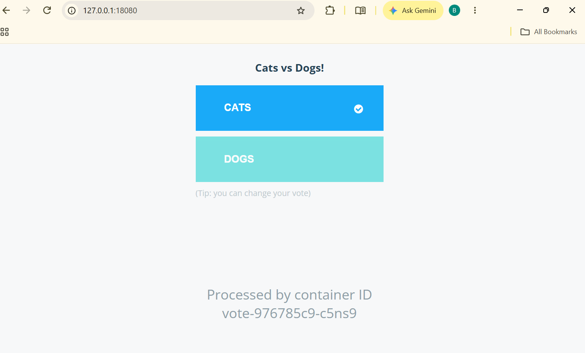
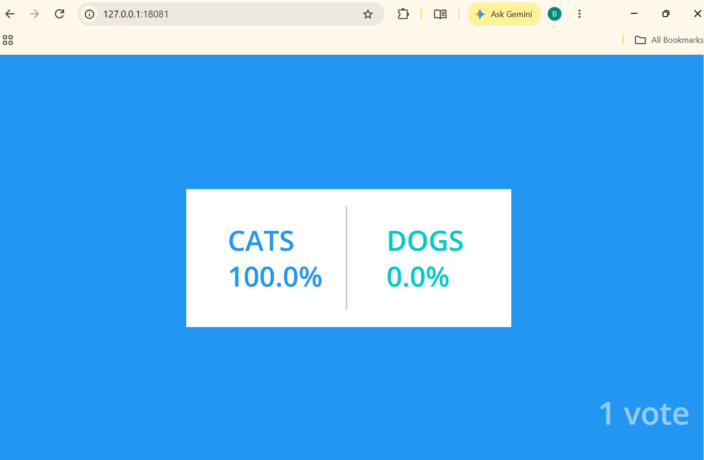
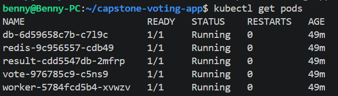
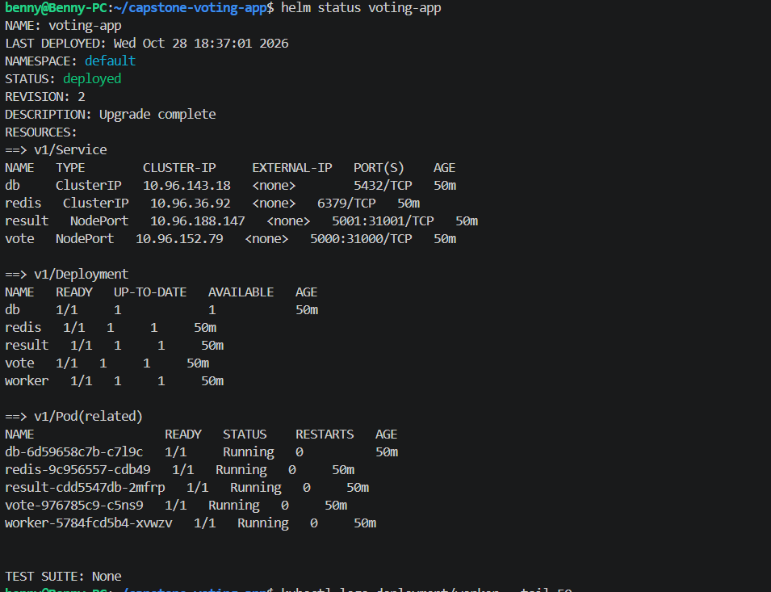
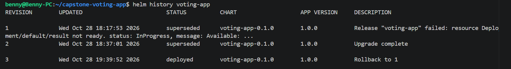
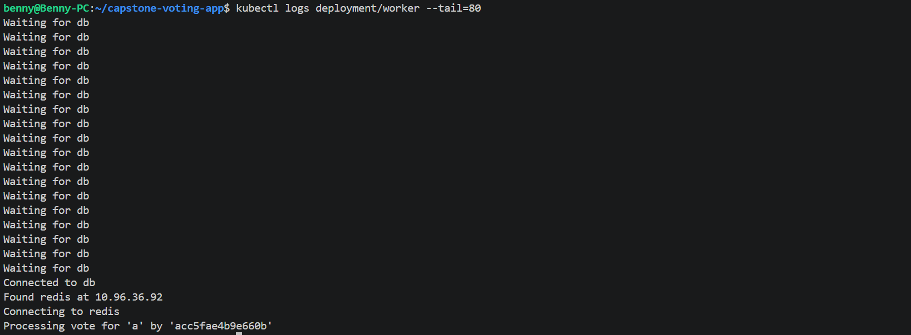

# Voting App Capstone

A containerized voting application deployed to Kubernetes with Helm. This project demonstrates container image builds and scanning, Kubernetes deployment, infrastructure-as-code, automated deployment checks, and Helm release recovery.

## Project summary

- **Application:** Vote, Result, Worker, Redis, and PostgreSQL workloads.
- **Local deployment:** Deployed and tested on a Kind Kubernetes cluster.
- **Application flow:** Submitted a vote through the Vote interface and confirmed the updated count on the Result interface.
- **Helm:** Chart linting and template rendering passed; the `voting-app` release reached the `deployed` state.
- **Rollback:** Performed a Helm rollback and checked workload health afterward.
- **Automation:** Both GitHub Actions workflows completed successfully on the latest commit that added the Kubernetes database Secret step.
- **AWS EKS:** Terraform configuration is included and validated, but an EKS cluster was not created because AWS Organizations policies denied `eks:CreateCluster` and `eks:CreateNodegroup`. Kind was used to continue validating Kubernetes and Helm without bypassing that restriction.

## Architecture


The application contains five workloads:

1. **Vote** — Python web interface where users submit a vote.
2. **Redis** — temporarily holds incoming votes.
3. **Worker** — reads votes from Redis and writes them to PostgreSQL.
4. **PostgreSQL** — stores the vote data.
5. **Result** — Node.js web interface that displays vote totals.

The Vote and Result services are exposed for local testing. Redis and PostgreSQL are internal cluster services.

## Repository layout

- `helm/voting-app/` — Helm chart and Kubernetes templates for the application workloads and services.
- `terraform/` — Terraform configuration for an AWS EKS cluster and managed node group.
- `k8s-specifications/` — standalone Kubernetes manifests.
- `.github/workflows/capstone-ci-cd.yml` — builds application images, scans them with Trivy, and publishes images to GitHub Container Registry on pushes to `main`.
- `.github/workflows/kind-deploy-test.yml` — creates an ephemeral Kind cluster, builds and loads application images, creates the database Secret, installs the Helm chart, waits for workloads, and smoke-tests both web apps.
- `architecture.excalidraw.png` — architecture diagram.
- `screenshots/` — screenshots documenting application functionality, Kubernetes workload status, Helm release status, and rollback.

## Tools used

Versions used during validation:

- Docker Engine 29.9.2
- kubectl 1.35.9
- Kind 0.30.0
- Helm 4.3.1
- Kubernetes v1.34.0 in the local Kind cluster

Compatible versions may also work.

## Deploy locally with Kind

From the repository root:

```bash
kind create cluster --name voting-app
kubectl cluster-info
kubectl get nodes
```

Create the database password as a Kubernetes Secret before installing the chart. Supply your own password locally; do not commit it to Git. If `db-secret` already exists in the cluster, skip the create command.

```bash
kubectl create secret generic db-secret \
  --from-literal=postgres-password='REPLACE_WITH_YOUR_PASSWORD'
```

Validate and install the chart:

```bash
helm lint ./helm/voting-app
helm template voting-app ./helm/voting-app
helm upgrade --install voting-app ./helm/voting-app --wait --timeout 5m
```

Check the release and workloads:

```bash
helm status voting-app
helm history voting-app
kubectl get deployments
kubectl get pods
kubectl get services
```

A healthy deployment should show the `db`, `redis`, `result`, `vote`, and `worker` deployments available and their pods in `Running` state with ready containers.

### Open the Vote and Result pages

Keep each port-forward command running in a separate terminal.

Terminal 1:

```bash
kubectl port-forward service/vote 18080:5000
```

Terminal 2:

```bash
kubectl port-forward service/result 18081:5001
```

Open:

- Vote page: http://127.0.0.1:18080
- Result page: http://127.0.0.1:18081

Submit a vote on the Vote page and confirm the updated count on the Result page. The port-forward processes must remain running while you use the pages.

### Useful diagnostics

```bash
kubectl get pods -o wide
kubectl describe pods
kubectl logs deployment/worker --tail=50
kubectl logs deployment/result --tail=50
```

Worker logs can be used to inspect Redis/database connectivity and vote processing. A body-parser deprecation warning appeared in the Result logs during testing, but the Result application still started and connected to the database.

## GitHub Actions

### Capstone CI CD

The workflow `.github/workflows/capstone-ci-cd.yml` builds the Vote, Result, and Worker images and scans them with Trivy for high and critical vulnerabilities. On pushes to `main`, it publishes images to GitHub Container Registry using the workflow's `GITHUB_TOKEN`.

The current Trivy configuration reports high and critical findings but uses `exit-code: '0'`; findings do not by themselves fail the job. Review scan output rather than interpreting a successful job as proof that no vulnerabilities exist.

Latest successful run: [Capstone CI CD](https://github.com/Benedictaokanya/example-voting-app/actions/runs/40773156217).

### Kind Kubernetes Deployment Check

The workflow `.github/workflows/kind-deploy-test.yml` creates a temporary Kind cluster on the GitHub runner, builds and loads the three application images, creates the `db-secret` Kubernetes Secret from the repository Actions secret `POSTGRES_PASSWORD`, installs the Helm chart, waits for all five deployments to roll out, and checks that the Vote and Result web apps return successful HTTP responses.

Latest successful run: [Kind Kubernetes Deployment Check](https://github.com/Benedictaokanya/example-voting-app/actions/runs/40773156289).

[View all GitHub Actions runs](https://github.com/Benedictaokanya/example-voting-app/actions).

## Deployment evidence

The following screenshots document the application's functionality, Kubernetes deployment state, Helm release, and rollback demonstration.

### Vote application



### Results application



### Kubernetes workloads



### Helm release status



### Helm rollback



### Worker logs



## Helm rollback

Helm release revisions allow a previous release revision to be restored. To inspect the release history and perform a rollback, use:

```bash
helm history voting-app
helm rollback voting-app <REVISION> --wait --timeout 5m
helm status voting-app
kubectl get deployments,pods
```

Replace `<REVISION>` with a revision shown by `helm history`. After a rollback, verify the workloads and confirm the Vote and Result pages still respond. The rollback evidence screenshot is included above.

## Terraform and AWS EKS limitation

The `terraform/` directory defines AWS EKS cluster and managed node group resources. The Terraform configuration was validated, but applying it was blocked because the AWS account's Organizations service control policy denied `eks:CreateCluster` and `eks:CreateNodegroup`. No EKS cluster was created by this project. The local Kind deployment and GitHub Actions Kind deployment check were used to validate the Kubernetes and Helm workflow without bypassing the account restriction.

To validate the Terraform configuration locally, from the `terraform/` directory:

```bash
terraform init -backend=false
terraform validate
terraform plan
```

A successful validation or plan does not mean AWS resources were created. An authorized AWS environment is required to deploy the EKS infrastructure.

## Security and limitations

- The Helm chart reads the PostgreSQL password from a pre-created Kubernetes Secret named `db-secret`, using the key `postgres-password`. The password is not stored in the chart's `values.yaml`.
- The Kind GitHub Actions workflow reads the password from the repository Actions secret `POSTGRES_PASSWORD`. Do not commit passwords or tokens to source control.
- Kubernetes Secrets require appropriate access controls and may need encryption at rest for shared or production environments.
- The chart uses `emptyDir` for database and Redis data. Those data directories are ephemeral and are not a production persistence strategy.
- Trivy findings should be reviewed; a successful scan job does not imply zero vulnerabilities.
- EKS deployment remains unverified because the AWS account policy blocked cluster creation.

## Cleanup

When you no longer need the local test cluster:

```bash
kind delete cluster --name voting-app
```

This removes the local Kind cluster and its workloads.
